<div align="center">

# ARCUS-STACK

**Stack universal Zero-MCP de habilidades y flujos de trabajo deep-first para 5 agentes de programacion IA**

<p>
  <a href="./README.md">English</a> |
  <a href="./README.ko.md">한국어</a> |
  <a href="./README.ja.md">日本語</a> |
  <a href="./README.zh-CN.md">简体中文</a> |
  <strong>Español</strong>
</p>

<p>
  
  
  
  
</p>

</div>

**ARCUS** (**A**gent **R**ules, **C**ommands & **U**niversal **S**kills) es un paquete de flujos de ingenieria basado exclusivamente en `SKILL.md` y `AGENTS.md` que funciona igual en **Antigravity (`agy`), Claude Code, Codex, Cursor y OpenCode**.

## Inicio rapido en 30 segundos

```bash
# Instala las 15 habilidades publicas globalmente en los 5 agentes
npx skills add sacru2red/arcus-stack -g -y
```

Ejecuta el flujo principal de inmediato en cualquier agente compatible:

```text
$arcus-mode      -> Punto de entrada recomendado: aplica principios, playbooks y habilidades automaticamente
$arcus-plan      -> Rastrea la causa raiz y genera una checklist con verificacion
$arcus-review    -> Audita el plan o diff en un subagente aislado sin sesgo del autor
$arcus-work-loop -> Implementa y marca cada paso solo tras superar pruebas y compilacion reales
```

---

## Fallos comunes al programar con IA y como los evita ARCUS

ARCUS bloquea siete fallos recurrentes de sesiones unicas de IA mediante estructura de flujo en lugar de simples peticiones en texto.

| Fallo recurrente en programacion con IA | Defensa estructural en ARCUS-STACK | Habilidad o modulo |
| :--- | :--- | :--- |
| Una sesion en curso no puede hacer una revision verdaderamente critica de su propio trabajo | **Revision en subagente aislado** sobre snapshot fijo + **Review Ledger (`F-01`..)** evaluando el codigo antes de leer respuestas | `arcus-review` |
| DDL destructivo (`DROP/RENAME COLUMN`) o bloqueante en un solo PR rompe despliegues rolling | Exige migracion sin caida en 4 fases (**Expand, Backfill y Verify, Contract**) en PRs separados | `safe-migration.md` |
| El agente sobrescribe la interfaz con un unico diseno sin consultar | Compara **Before + 3 opciones** en la rama de trabajo, aplica solo la elegida y prepara capturas **Before/After** para el PR | `arcus-ui-propose` |
| Consultas sin paginacion, bucles N+1 y llamadas HTTP/LLM dentro de transacciones DB llegan a produccion | Reglas bajo demanda para limites de consulta, I/O fuera de transacciones, reintentos con jitter y ocultacion de PII en logs | `backend-reliability.md` |
| Se revisa solo autenticacion y se escapan IDOR, secretos filtrados y paquetes vulnerables | **Auditoria aislada de fronteras de confianza y authz**, ocultacion de secretos, pruebas negativas locales y registro `S-01`.. | `arcus-security` |
| Parches antiguos de APIs web y archivos `AGENTS.md` inflados con reglas muertas | **Consulta en vivo de estandares web de Chrome** + escalado de errores repetidos a tipos, lints y tests eliminando prosa obsoleta | `modern-web-guidance`, `arcus-correct` |
| Cambios entregados con resumenes vagos que ocultan el mecanismo y los trade-offs | **Briefing de ingenieria automatico** tras planes e implementaciones con modelo mental CS, mecanismo y trade-offs claros | `arcus-explain` |

---

## Flujo de entrega de extremo a extremo

Planificacion, critica aislada, ejecucion con guardrails, escalado de seguridad, higiene de reglas y briefing final forman un ciclo cerrado.

<picture>
  <source media="(prefers-color-scheme: dark)" srcset="./assets/diagrams/pipeline-dark.svg">
  <source media="(prefers-color-scheme: light)" srcset="./assets/diagrams/pipeline-light.svg">
  
</picture>

*Figura 1. Ciclo completo desde `$arcus-plan` pasando por `$arcus-review` aislado, `$arcus-work-loop`, escalado de seguridad `$arcus-security`, higiene de reglas `$arcus-correct` y cierre con `$arcus-explain`.*

---

## Cinco capacidades principales

### 1. Revision con contexto aislado y Review Ledger basado en codigo (`arcus-review`)
Un revisor que comparte la conversacion del autor comparte tambien sus puntos ciegos. `arcus-review` fija un commit o diff y lanza un subagente aislado para ejecutar la prueba de lector en frio (Cold-Reader Test) y contrastar documentacion externa. Desde la Ronda 2, el revisor juzga cada hallazgo abierto mirando **primero el nuevo snapshot de codigo antes de leer las respuestas del autor**.

**Ejemplo: formato de salida del Review Ledger de `$arcus-review`**

| ID | Ronda | Snapshot Fijo | Severidad | Destino | Escenario de Fallo y Accion Requerida | Estado |
| :--- | :--- | :--- | :--- | :--- | :--- | :--- |
| `F-01` | R1 | `4e058ee` | `CRITICAL` | `worker.md:7` | Preguntar a mitad de un bucle autonomo bloquea al subagente. Diferir la pregunta al turno principal. | `RESOLVED` |
| `F-02` | R1 | `4e058ee` | `HIGH` | `SKILL.md:44` | Ruta relativa falla en instalacion parcial. Incluir reglas de respaldo dentro de la habilidad. | `VALID_PUSHBACK` |

*(Estados: `OPEN` · `RESOLVED` · `UNRESOLVED` · `VALID_PUSHBACK` · `DISPUTED`)*

### 2. Comparacion visual UI de 4 opciones y capturas Before/After para PR (`arcus-ui-propose`)
En cambios visuales de UI, captura 1 referencia (`00-before.png`) y 3 propuestas distintas (`Option A/B/C`) sobre tu rama mediante un ciclo limpio de **aplicar, capturar, guardar `.patch` y revertir con `git checkout`**. Tras pulir la opcion elegida, captura `99-after-final.png` con el mismo viewport y tema, y la integra con subida automatica en GitLab MR o entrega segura en GitHub PR sin contaminar la rama con PNGs binarios.

### 3. Migraciones sin tiempo de inactividad y fiabilidad backend (`safe-migration.md`, `backend-reliability.md`)
- **Migraciones sin caida (`safe-migration.md`)**: Excluye esquemas de BD en produccion, colas/caches persistentes y contratos rolling-deploy de la refactorizacion en una sola ola, exigiendo DDL online/`CONCURRENTLY`, escritura dual, backfill idempotente por lotes, validacion de rollback `N-1`/`N` y PR Contract separado.
- **Fiabilidad backend (`backend-reliability.md`)**: Se carga bajo demanda para imponer limites en listas, eliminar N+1, sacar I/O externo de transacciones DB, exigir timeouts y cancelacion, limitar reintentos con jitter solo a fallos transitorios y evitar secretos o PII en logs.

### 4. Auditorias de seguridad, authz y cadena de suministro con PoC (`arcus-security`)
Se activa cuando el diff toca authn/authz, facturacion, secretos o PII, sumideros de entrada no confiable, workflows CI o manifiestos de dependencias. Oculta secretos en formato `sk_live_***`, demuestra hallazgos `CRITICAL`/`HIGH` con **pruebas negativas locales aisladas** (nunca contra produccion o staging) y rastrea resultados en un Security Ledger dedicado (`S-01`, `S-02`, ...).

### 5. Estandares web en vivo, visualizacion de arquitectura e higiene de reglas (`modern-web-guidance`, `archify`, `arcus-onboard`, `arcus-correct`)
- **Estandares web modernos**: Consulta `npx -y modern-web-guidance@latest` antes de escribir HTML, CSS o JS cliente para usar el estado real de Web Platform Baseline y anadir respaldos `@supports` solo cuando hacen falta.
- **Visualizacion de arquitectura (`archify`)**: Prioriza `tt-a1i/archify` en 10 tipos de diagramas aislando archivos temporales en el directorio temporal del sistema (`D-010`).
- **Mapa de dominio e higiene de reglas**: `arcus-onboard` mantiene un `ONBOARDING.md` de 1 a 2 paginas con etiquetas de fecha y origen, y `arcus-correct` convierte errores repetidos en arquitectura, tipos, lints o tests mientras elimina reglas muertas o obsoletas.

---

## Arquitectura de encapsulacion en dos niveles

Colocar decenas de reglas granulares en el primer nivel de `skills/` satura el menu (`/`) y desperdicia contexto en cada turno. Como los 5 agentes escanean solo un nivel bajo `skills/`, `arcus-stack` separa puntos de entrada publicos de modulos internos.

<picture>
  <source media="(prefers-color-scheme: dark)" srcset="./assets/diagrams/architecture-dark.svg">
  <source media="(prefers-color-scheme: light)" srcset="./assets/diagrams/architecture-light.svg">
  
</picture>

*Figura 2. Encapsulacion en dos niveles que mantiene solo 15 habilidades publicas en el menu mientras carga bajo demanda los modulos internos de `skills/arcus-mode/`, las carpetas `references/` de cada habilidad y `DECISIONS.md` en la raiz.*

- **Tier 1 (15 habilidades publicas)**: Solo `skills/arcus-*/SKILL.md` aparece en tu menu. Las habilidades autonomas incluyen sus propias `references/` (11 archivos) para funcionar en instalaciones parciales.
- **Tier 2 (`skills/arcus-mode/` 68 modulos internos + `worker.md`)**: 24 principios, 23 playbooks, 20 sub-habilidades internas y 1 referencia (`bugbot-triage.md`) permanecen ocultos y se cargan por enlace relativo solo cuando aplican.

---

## `arcus-mode` vs. `arcus-work-loop`

| Dimension | `arcus-mode` (Modo maestro) | `arcus-work-loop` (Motor de ejecucion de checklist) |
| :--- | :--- | :--- |
| **Rol** | Controla el criterio de ingenieria, estilo conciso y delegacion en subagentes durante toda la sesion. | Toma una checklist `- [ ]` confirmada y ejecuta el ciclo implementar, verificar, corregir y marcar `[x]`. |
| **Alcance** | Amplio: elige dinamicamente entre 24 principios, 23 playbooks y 20 modulos internos. | Enfocado: toma la lista de `arcus-plan` y continua hasta que pasen pruebas y compilacion reales. |
| **Cuando usarlo** | Al iniciar sesion o ante tareas abiertas de arquitectura, depuracion o rendimiento. | Tras aprobar el plan, cuando quieres ejecucion y verificacion completas sin pausas intermedias. |

---

## 15 habilidades principales de un vistazo

### 1. Flujo principal diario (5)
| Habilidad | Cuando usarla | Resultado |
| :--- | :--- | :--- |
| **`arcus-mode`** | Inicio de sesion, ingenieria abierta | Enrutamiento automatico de 24 principios, 23 playbooks, prosa concisa y subagentes |
| **`arcus-plan`** | Antes de tocar codigo de produccion | Causa raiz, radio de impacto y checklist ejecutable con verificacion (`- [ ]`) |
| **`arcus-work-loop`** | Implementar un plan aprobado | Bucle autonomo que marca `- [x]` solo tras evidencia real de tests y build |
| **`arcus-review`** | Auditar un plan, diff o PR | Revision aislada basada en codigo con Findings Ledger persistente (`F-01`..) |
| **`arcus-explain`** | Alinear objetivos o explicar cambios | Briefing claro con modelo mental CS, mecanismo, trade-offs y verificacion |

### 2. Seguridad, UI visual y verificacion (4)
| Habilidad | Cuando usarla | Resultado |
| :--- | :--- | :--- |
| **`arcus-security`** | Auditoria de authz, pagos, secretos, CI o dependencias | Pruebas negativas locales PoC, secretos ocultos, auditoria sin bloqueos y registro `S-01`.. |
| **`arcus-ui-propose`** | Cambios de layout, estilos o componentes UI | 1 captura Before + 3 variantes, archivos `.patch` reutilizables y aplicacion limpia |
| **`arcus-create-verification`** | Falta verificacion de app desde vista de usuario | Habilidad local `verify-<app>` que ejecuta y prueba flujos reales de usuario |
| **`arcus-maintain-verification`** | Cambios recientes dejaron obsoleta la verificacion | Guia de verificacion y mapa de funciones actualizados frente al codigo y la app en vivo |

### 3. Dominio, historial e higiene de reglas (4)
| Habilidad | Cuando usarla | Resultado |
| :--- | :--- | :--- |
| **`arcus-onboard`** | Entrar a un repo o documentar reglas de negocio | `ONBOARDING.md` de 1 a 2 paginas (mapeos, invariantes, zonas criticas) con fechas |
| **`arcus-why`** | Entender por que el codigo actual existe asi | Razones citadas desde `DECISIONS.md`, commits de Git y discusiones en PRs |
| **`arcus-correct`** | Errores repetidos del agente o reglas infladas | Escalado a arquitectura, tipos, lints o tests; poda de reglas muertas o fragiles |
| **`arcus-ketchup`** | Ponerse al dia tras una sesion larga | Resumen claro de cambios y decisiones pendientes desde tu ultimo mensaje |

### 4. Personalizacion y conversion (2)
| Habilidad | Cuando usarla | Resultado |
| :--- | :--- | :--- |
| **`arcus-automate-me`** | Evitar repetir tus preferencias en cada sesion | Habilidad personal `*-mode` basada en historial reciente y breve entrevista |
| **`arcus-skill-maker`** | Portar habilidades externas a los 5 agentes | Habilidad `arcus-*` Zero-MCP validada segun la especificacion universal |

### Que comando debo usar?
- *"Rastrea la causa raiz de este fallo o funcion y arma un plan verificable"* -> **`$arcus-plan`**
- *"Revisa mi plan o PR diff en busca de omisiones y defectos"* -> **`$arcus-review`**
- *"Ejecuta esta checklist hasta que pasen todas las pruebas y compilaciones"* -> **`$arcus-work-loop`**
- *"Muestrame 3 propuestas visuales en capturas frente a la pantalla actual"* -> **`$arcus-ui-propose`**
- *"Audita este cambio contra IDOR, secretos filtrados y dependencias vulnerables"* -> **`$arcus-security`**
- *"Evita que el agente repita este error usando tipos, lints o tests"* -> **`$arcus-correct`**
- *"Elige automaticamente las habilidades y principios adecuados para toda la sesion"* -> **`$arcus-mode`**

---

## Instalacion, estructura de directorios y creditos

<details>
<summary><strong>Todos los metodos de instalacion y actualizacion (por proyecto, plugins, enlaces locales, limpieza)</strong></summary>

### Metodo 1. CLI `npx skills` (recomendado)

```bash
# Instalar o actualizar todas las habilidades globalmente en los 5 agentes
npx skills add sacru2red/arcus-stack -g -y
# o
npx skills update

# Instalar habilidades especificas solo en el proyecto actual
npx skills add sacru2red/arcus-stack --skill arcus-mode --skill arcus-plan --skill arcus-work-loop
```

> **Limpieza de habilidades renombradas (`D-003`):** `npx skills add` y `update` no eliminan automaticamente habilidades renombradas (`arcus-work` a `arcus-work-loop`, `arcus-in-your-own-words` a `arcus-explain`). Elimina los nombres antiguos una vez si siguen visibles:
> ```bash
> npx skills remove arcus-work arcus-in-your-own-words -g -y
> ```

### Metodo 2. Gestores de plugins nativos

- **Antigravity (`agy`)**:
  ```bash
  agy plugin install https://github.com/sacru2red/arcus-stack
  ```
- **Claude Code**:
  ```bash
  /plugin marketplace add https://github.com/sacru2red/arcus-stack
  /plugin install arcus-stack
  # Actualizar
  /plugin update arcus-stack
  ```

### Metodo 3. Clon local + enlaces simbolicos globales (`scripts/install-global.ps1` / `.sh`)

Enlaza las 15 habilidades publicas a las carpetas globales de los 5 agentes, incluido el entorno aislado de Antigravity en T3 Code.

```powershell
# Windows (PowerShell)
.\scripts\install-global.ps1
```

```bash
# macOS / Linux
./scripts/install-global.sh
```

Como los enlaces apuntan a tu clon local, `git pull` actualiza todos los agentes al instante (vuelve a ejecutar el script solo si se agrega una nueva carpeta de habilidad).

</details>

<details>
<summary><strong>Estructura completa de directorios y comando de validacion</strong></summary>

```text
arcus-stack/
├── README.md                    # Documentacion principal en ingles (English)
├── README.ko.md                 # Documentacion en coreano (Korean)
├── README.ja.md                 # Documentacion en japones (Japanese)
├── README.zh-CN.md              # Documentacion en chino simplificado (Simplified Chinese)
├── README.es.md                 # Documentacion en espanol (Spanish)
├── DECISIONS.md                 # Registro de decisiones arquitectonicas (D-001..D-013)
├── plugin.json                  # Manifiesto de plugin para Antigravity (agy)
├── .claude-plugin/
│   └── plugin.json              # Manifiesto de plugin para Claude Code
├── .agents/
│   └── skills.json              # Manifiesto de descubrimiento de habilidades del workspace
├── AGENTS.md                    # Puente de reglas raiz
├── CLAUDE.md                    # Puente de reglas para Claude Code
├── assets/
│   └── diagrams/                # SVGs estaticos Dark/Light generados con archify (4 archivos)
│       ├── pipeline-dark.svg
│       ├── pipeline-light.svg
│       ├── architecture-dark.svg
│       └── architecture-light.svg
├── rules/
│   └── AGENTS.md                # Reglas centrales de ingenieria compartidas en los 5 agentes
├── scripts/
│   ├── install-global.ps1       # Instalador global de enlaces en Windows (5 agentes + T3 Code)
│   ├── install-global.sh        # Instalador global de enlaces en macOS/Linux (5 agentes + T3 Code)
│   └── validate.ps1             # Validador de frontmatter, enlaces relativos, 15 habilidades y portabilidad
└── skills/                      # 15 habilidades publicas (+ 11 archivos en references/ por habilidad)
    ├── arcus-mode/              # Modo maestro + 68 modulos internos encapsulados + worker.md
    │   ├── SKILL.md
    │   ├── worker.md
    │   ├── playbooks/           # [Interno] 23 playbooks de tareas (safe-migration, opening-a-pr, ...)
    │   ├── principles/          # [Interno] 24 principios de ingenieria
    │   ├── internal/            # [Interno] 20 sub-habilidades auxiliares (backend-reliability, typescript-best-practices, modern-web-guidance, archify-visualization, ...)
    │   └── references/          # [Interno] 1 referencia (bugbot-triage.md)
    ├── arcus-plan/
    ├── arcus-work-loop/
    ├── arcus-review/
    ├── arcus-explain/
    ├── arcus-security/
    ├── arcus-ui-propose/
    ├── arcus-create-verification/
    ├── arcus-maintain-verification/
    ├── arcus-ketchup/
    ├── arcus-why/
    ├── arcus-correct/
    ├── arcus-automate-me/
    ├── arcus-onboard/
    └── arcus-skill-maker/
```

Vuelve a verificar las 15 habilidades publicas, el frontmatter YAML y los enlaces relativos en cualquier momento:

```powershell
.\scripts\validate.ps1
```

</details>

<details>
<summary><strong>Seis proyectos open source de inspiracion y atribuciones de licencia</strong></summary>

- [`pstack`](https://github.com/cursor/plugins/tree/main/pstack): *"Si quieres ir rapido, profundiza primero."* (Analisis de causa raiz, radio de impacto minimo, codigo verificable)
- [`oh-my-openagent`](https://github.com/code-yeongyu/oh-my-openagent): Bucles de ejecucion autonoma y separacion entre estrategia y ejecucion
- [`oh-my-claudecode`](https://github.com/yeachan-heo/oh-my-claudecode): Delegacion por roles y flujos autopilot
- [`oh-my-antigravity`](https://github.com/Joonghyun-Lee-Frieren/oh-my-antigravity): Barreras de calidad por etapas y cierre basado en evidencia real
- [`GoogleChrome/modern-web-guidance`](https://github.com/GoogleChrome/modern-web-guidance): Consulta en vivo de estandares web modernos para HTML, CSS y JS cliente (Apache-2.0)
- [`tt-a1i/archify`](https://github.com/tt-a1i/archify): Motor de visualizacion interactiva y SVG estatico en 10 tipos de diagramas (Apache-2.0)

</details>
