<div align="center">

# ARCUS-STACK

**5つのAIコーディングエージェントすべてで同じように動く Zero-MCP ディープファースト・スキル＆ワークフロースタック**

<p>
  <a href="./README.md">English</a> |
  <a href="./README.ko.md">한국어</a> |
  <strong>日本語</strong> |
  <a href="./README.zh-CN.md">简体中文</a> |
  <a href="./README.es.md">Español</a>
</p>

<p>
  
  
  
  
</p>

</div>

**ARCUS**（**A**gent **R**ules, **C**ommands & **U**niversal **S**kills）は、**Antigravity (`agy`)、Claude Code、Codex、Cursor、OpenCode** すべてで共通の標準仕様（`SKILL.md` + `AGENTS.md`）だけで動作するエンジニアリング・ワークフロースタックです。

## 30秒クイックスタート

```bash
# PC内の5つのエージェントすべてに15個の公開コアスキルを一括インストール
npx skills add sacru2red/arcus-stack -g -y
```

インストール後、どのエージェントからでもすぐに主要パイプラインを実行できます。

```text
$arcus-mode      -> 推奨デフォルト: 状況に合う原則・プレイブック・スキルを自動適用
$arcus-plan      -> 根本原因を特定し、検証条件付きの実行チェックリストを作成
$arcus-review    -> 作成者のバイアスを排した隔離サブエージェントで計画・差分を監査
$arcus-work-loop -> 実際のビルド・テスト証拠を通過した項目だけを完了させ最後まで実装
```

---

## 従来のAIコーディングの課題と ARCUS の解決策

単一セッションのAIコーディングで繰り返される7つの失敗を、お願いベースのプロンプトではなくワークフロー構造で防ぎます。

| 従来のAIコーディングの繰り返し失敗 | ARCUS-STACK の構造的な解決策 | 担当スキル / モジュール |
| :--- | :--- | :--- |
| 作業中のセッションは自分の成果物に対して本当に批判的なレビューができない | スナップショット固定の **隔離サブエージェントレビュー** ＋ 返信より先にコードを判定する **指摘台帳（`F-01`..）** | `arcus-review` |
| 単一PRで `DROP/RENAME COLUMN` やブロッキングDDLを実行し本番障害を起こす | **Expand、Backfill & Verify、Contract** の4段階無停止マイグレーションをPR分割で強制 | `safe-migration.md` |
| UI作業でエージェントが1つのデザインに決め打ちして上書きする | 作業ブランチで **Before ＋ 3案** を比較して選んだ案のみ適用し、PR用の **Before/After スクリーンショット** まで準備 | `arcus-ui-propose` |
| ページネーションなし取得、N+1、DBトランザクション内の外部HTTP/LLM呼出を混入する | クエリ上限、トランザクション外I/O分離、冪等・ジッター付きリトライ、PIIログマスクをオンデマンド適用 | `backend-reliability.md` |
| 認証だけ確認してオブジェクト認可（IDOR）・シークレット漏洩・依存脆弱性を見落とす | 隔離コンテキストによる **信頼境界・認可監査**、シークレットマスク、ローカル専用負テスト、セキュリティ台帳（`S-01`..） | `arcus-security` |
| 古いWeb APIの回避コード量産と `AGENTS.md` ルール肥大化 | **Chrome最新Web標準のリアルタイム照会** ＋ 繰り返しミスを型・Lintへ昇格し不要ルールを削除 | `modern-web-guidance`, `arcus-correct` |
| コード変更後に曖昧な要約しか残らず、仕組みとトレードオフが追いにくい | 計画・実装完了ごとに独自用語を標準CSモデル・動作原理・トレードオフへ翻訳する **要点ブリーフィングを自動出力** | `arcus-explain` |

---

## エンドツーエンド・デリバリーパイプライン

計画立案、隔離レビュー、ガードレール付き自律実行、セキュリティ監査、ルール衛生管理、最終ブリーフィングが1つの閉じたループとして連携します。

<picture>
  <source media="(prefers-color-scheme: dark)" srcset="./assets/diagrams/pipeline-dark.svg">
  <source media="(prefers-color-scheme: light)" srcset="./assets/diagrams/pipeline-light.svg">
  
</picture>

*図1. `$arcus-plan` から隔離 `$arcus-review`、`$arcus-work-loop`、高リスク時の `$arcus-security` エスカレーション、`$arcus-correct` によるルール改善、`$arcus-explain` ブリーフィングへつながるデリバリーパイプライン。*

---

## 5つのコア機能

### 1. コンテキスト隔離レビューとコード優先の指摘台帳 (`arcus-review`)
作成者と対話文脈を共有するレビュアーは同じ死角も共有します。`arcus-review` はコミットまたはdiffスナップショットを固定し、新しい隔離サブエージェントで前提知識なしの読解テスト（Cold-Reader Test）と外部公式ドキュメント照合を実行します。2回目以降は作成者の説明を読む前に **最新コードスナップショットだけを見て** 未解決指摘を判定します。

**例: `$arcus-review` 指摘台帳の出力フォーマット**

| ID | 回次 | 固定スナップショット | 重大度 | 対象箇所 | 問題シナリオと必要な修正 | 状態 |
| :--- | :--- | :--- | :--- | :--- | :--- | :--- |
| `F-01` | R1 | `4e058ee` | `CRITICAL` | `worker.md:7` | 自律サブエージェント実行中の質問呼び出しで停止する。最上位ターンへ委譲が必要。 | `RESOLVED` |
| `F-02` | R1 | `4e058ee` | `HIGH` | `SKILL.md:44` | 部分インストール時に相対パス参照が切れる。スキル本文へフォールバック規則を内蔵。 | `VALID_PUSHBACK` |

*(ステータス: `OPEN` · `RESOLVED` · `UNRESOLVED` · `VALID_PUSHBACK` · `DISPUTED`)*

### 2. UI 4案スクリーンショット比較と PR Before/After スクリーンショット (`arcus-ui-propose`)
視覚的なUI変更では、作業前（`00-before.png`）1枚と異なる3案（`Option A/B/C`）を作業ブランチ上で **順次適用、撮影、`.patch` 保存、`git checkout` 復元** の手順で安全に比較します。採用案の実装完了後は同じビューポート・テーマで `99-after-final.png` を再撮影し、GitLab MR 自動アップロードまたは GitHub PR 安全ハンドオフ（ブランチへのバイナリPNG混入防止）へ連携します。

### 3. 無停止DBマイグレーションとバックエンド信頼性ガードレール (`safe-migration.md`, `backend-reliability.md`)
- **無停止マイグレーション (`safe-migration.md`)**: 本番DBスキーマ、永続キュー/キャッシュ、ローリングデプロイ契約を単一ウェーブのリファクタリングから除外し、オンライン/`CONCURRENTLY` DDL、二重書き込み、チャンク冪等バックフィル、`N-1`/`N` ロールバック確認、後続 Contract PR 分割を強制します。
- **バックエンド信頼性 (`backend-reliability.md`)**: クエリ上限、N+1解消、DBトランザクション外への外部I/O分離、明示的タイムアウトとキャンセル伝播、一時障害限定のジッター付きリトライ、シークレット・PIIマスク済み構造化ログをオンデマンド適用します。

### 4. PoC ベースのセキュリティ・認可・サプライチェーン監査 (`arcus-security`)
認証/認可、課金、PII/シークレット、外部入力シンク、CIワークフロー、依存マニフェストの変更時に隔離監査へ切り替えます。シークレットは `sk_live_***` 形式でマスク報告し、`CRITICAL`/`HIGH` 項目は本番・ステージングではなく **ローカル隔離の負テスト** で実証し、専用台帳（`S-01`, `S-02`, ...）で管理します。

### 5. 最新Web標準照会・アーキテクチャ可視化・ルール衛生 (`modern-web-guidance`, `archify`, `arcus-onboard`, `arcus-correct`)
- **最新Web標準の自動照会**: HTML/CSS/クライアントJS実装前に `npx -y modern-web-guidance@latest` で Google Chrome 公式ガイドと Web Platform Baseline を確認し、必要な `@supports` フォールバックのみ実装します。
- **アーキテクチャ可視化 (`archify`)**: 10種の図解リクエストで `tt-a1i/archify` をOS一時ディレクトリ隔離（`D-010`）のもと最優先で使用します。
- **ドメイン地図とルール衛生**: `arcus-onboard` が日付・出典タグ付きの `ONBOARDING.md` を維持し、`arcus-correct` が繰り返しミスを構造・型・Lint・テストへ昇格させ不要なルールを整理します。

---

## 2階層スキルカプセル化アーキテクチャ

細かいルールを最上位 `skills/` に並べるとスラッシュメニュー（`/`）が溢れ、毎ターンのコンテキストを消費します。5つのエージェントが `skills/` 直下1階層だけを登録する仕様を利用し、2階層に分離しています。

<picture>
  <source media="(prefers-color-scheme: dark)" srcset="./assets/diagrams/architecture-dark.svg">
  <source media="(prefers-color-scheme: light)" srcset="./assets/diagrams/architecture-light.svg">
  
</picture>

*図2. メニューには15個の公開コアスキルのみを表示し、`skills/arcus-mode/` 内部モジュール、各スキル `references/`、ルート `DECISIONS.md` を必要時のみ相対リンクで読み込む2階層構造。*

- **Tier 1（公開コアスキル15種）**: `skills/arcus-*/SKILL.md` のみがメニューに表示されます。各コアスキルは固有の `references/`（11ファイル）を同梱し、部分インストールでも独立動作します。
- **Tier 2（`skills/arcus-mode/` 内部モジュール69個 ＋ `worker.md`）**: 原則24、プレイブック23、内部補助スキル21、リファレンス1（`bugbot-triage.md`）をメニュー外に格納し、必要時のみロードします。

---

## `arcus-mode` vs `arcus-work-loop`

| 比較項目 | `arcus-mode`（マスター動作モード） | `arcus-work-loop`（チェックリスト実行エンジン） |
| :--- | :--- | :--- |
| **役割** | セッション全体の設計判断、簡潔な文体、サブエージェント委譲規則を統括します。 | 確定した `- [ ]` チェックリストを受け取り、実装、検証、修正、完了（`[x]`）を完走します。 |
| **適用範囲** | 24原則・23プレイブック・21内部モジュールから状況に合う手順を自動選択します。 | `arcus-plan` のチェックリストを引き継ぎ、実ビルド・テスト通過まで反復実行します。 |
| **使い分け** | セッション開始時や、原因調査・設計探索・性能改善など複合判断が必要なとき。 | 計画確定後、途中で止まらず最後まで実装と検証をやり切らせたいとき。 |

---

## 15個のコアスキル一覧

### 1. 日常コアパイプライン（5種）
| スキル | いつ使うか | 得られる結果 |
| :--- | :--- | :--- |
| **`arcus-mode`** | セッション開始、複合的な設計・デバッグ | 24原則・23プレイブック・簡潔文体・サブエージェント委譲の自動適用 |
| **`arcus-plan`** | 本番コード編集前の設計・原因調査 | 根本原因、影響範囲、検証条件付きの実行チェックリスト（`- [ ]`） |
| **`arcus-work-loop`** | 承認済み計画の完遂 | 実テスト・ビルド通過項目のみ `- [x]` にする自律実行ループ |
| **`arcus-review`** | 計画・PR/diffの客観的監査 | 隔離サブエージェントによるコード優先判定と Findings Ledger（`F-01`..） |
| **`arcus-explain`** | 目標すり合わせ・変更内容の理解 | 独自用語を標準CSモデル・動作原理・トレードオフで要約したブリーフィング |

### 2. セキュリティ・視覚UI・アプリ検証（4種）
| スキル | いつ使うか | 得られる結果 |
| :--- | :--- | :--- |
| **`arcus-security`** | 認可、課金、シークレット、CI/依存監査 | ローカル負テストPoC、シークレットマスク報告、非ブロッキング監査、`S-01`.. 台帳 |
| **`arcus-ui-propose`** | レイアウト・スタイル・UIコンポーネント変更 | Before 1枚 ＋ 3案スクリーンショット比較、`.patch` 保存、採用案の即時適用 |
| **`arcus-create-verification`** | ユーザー視点のアプリ検証手順がないとき | アプリを起動・操作するプロジェクト専用 `verify-<app>` スキル |
| **`arcus-maintain-verification`** | 機能変更で既存検証手順が古くなったとき | 最新コードと実動作を照合して更新した検証スキルと機能一覧 |

### 3. ドメイン知識・履歴・ルール衛生（4種）
| スキル | いつ使うか | 得られる結果 |
| :--- | :--- | :--- |
| **`arcus-onboard`** | 新規リポジトリ参画・ドメイン仕様整理 | 日付・出典タグ付き1〜2ページの `ONBOARDING.md`（用語対応・不変条件・地雷原） |
| **`arcus-why`** | 既存コードの設計意図を知りたいとき | `DECISIONS.md`・コミット・PR議論を根拠リンク付きで追跡した回答 |
| **`arcus-correct`** | 同じミスが繰り返される・ルールが肥大化したとき | ミスを構造・型・Lint・テストへ昇格し、不要ルールや陳腐化した事実記述を削除 |
| **`arcus-ketchup`** | 長い対話後に変更点と決定事項だけ見たいとき | 前回メッセージ以降の変更要約とすぐ判断できるアクション一覧 |

### 4. 個人化・外部スキル変換（2種）
| スキル | いつ使うか | 得られる結果 |
| :--- | :--- | :--- |
| **`arcus-automate-me`** | 好みのコーディングスタイルを毎回伝えたくないとき | 最近の対話分析と短いヒアリングで作る専用 `*-mode` スキル |
| **`arcus-skill-maker`** | 外部スキルを5エージェント共通で使いたいとき | Zero-MCP 汎用仕様に準拠した `arcus-*` スキルへの変換・検証 |

### 状況別コマンド早見表
- *「この機能やバグの原因を突き止めて実行計画を作って」* -> **`$arcus-plan`**
- *「いま作った計画やPR差分の抜け漏れ・欠陥を監査して」* -> **`$arcus-review`**
- *「確定したチェックリストをテスト通過まで実装して」* -> **`$arcus-work-loop`**
- *「UI変更を3案のスクリーンショットで比較して見せて」* -> **`$arcus-ui-propose`**
- *「権限バイパス（IDOR）、シークレット漏洩、依存脆弱性を監査して」* -> **`$arcus-security`**
- *「繰り返されるエージェントのミスを型・Lint・テストで防いで」* -> **`$arcus-correct`**
- *「状況に合わせて上のスキルと原則を自動で選んでセッション全体を進めて」* -> **`$arcus-mode`**

---

## 詳細インストールとディレクトリ構造

<details>
<summary>インストール・アップデート全手順（プロジェクト単位・プラグイン・ローカルリンク・旧スキル整理）</summary>

### 方法 1. `npx skills` CLI（推奨）

```bash
# 5つのエージェントすべてにグローバルインストール・更新
npx skills add sacru2red/arcus-stack -g -y
# または
npx skills update

# 現在のプロジェクトに必要なスキルだけを選択インストール
npx skills add sacru2red/arcus-stack --skill arcus-mode --skill arcus-plan --skill arcus-work-loop
```

> **名前が変更された旧スキルの整理 (`D-003`):** `npx skills add`/`update` はリポジトリ側で改名された旧スキル（`arcus-work` -> `arcus-work-loop`、`arcus-in-your-own-words` -> `arcus-explain`）を自動削除しません。旧名が一覧に残っている場合は1度削除してください。
> ```bash
> npx skills remove arcus-work arcus-in-your-own-words -g -y
> ```

### 方法 2. 各エージェントのネイティブプラグインマネージャー

- **Antigravity (`agy`)**:
  ```bash
  agy plugin install https://github.com/sacru2red/arcus-stack
  ```
- **Claude Code**:
  ```bash
  /plugin marketplace add sacru2red/arcus-stack
  /plugin install arcus-stack@arcus-stack
  # アップデート
  /plugin update arcus-stack@arcus-stack
  ```

### 方法 3. ローカルクローン + グローバルシンボリックリンク (`scripts/install-global.ps1` / `.sh`)

5つのエージェントと T3 Code 内の Antigravity 環境へ15個の公開スキルを一括リンクします。

```powershell
# Windows (PowerShell)
.\scripts\install-global.ps1
```

```bash
# macOS / Linux
./scripts/install-global.sh
```

シンボリックリンクがローカルクローンを直接指すため、`git pull` だけで即時反映されます（最上位スキルフォルダが新規追加された場合のみスクリプトを1回再実行）。

</details>

<details>
<summary>ディレクトリ構造と検証コマンド</summary>

```text
arcus-stack/
├── README.md                    # 英語メインドキュメント (English)
├── README.ko.md                 # 韓国語ドキュメント (Korean)
├── README.ja.md                 # 日本語ドキュメント (Japanese)
├── README.zh-CN.md              # 中国語簡体字ドキュメント (Simplified Chinese)
├── README.es.md                 # スペイン語ドキュメント (Spanish)
├── DECISIONS.md                 # アーキテクチャ意思決定記録 (D-001..D-013)
├── plugin.json                  # Antigravity (agy) プラグインマニフェスト
├── .claude-plugin/
│   └── plugin.json              # Claude Code プラグインマニフェスト
├── .agents/
│   └── skills.json              # ワークスペーススキル検出マニフェスト
├── AGENTS.md                    # ルートルールブリッジ
├── CLAUDE.md                    # Claude Code ルールブリッジ
├── assets/
│   └── diagrams/                # archify 生成 GitHub Dark/Light 静的 SVG (4ファイル)
│       ├── pipeline-dark.svg
│       ├── pipeline-light.svg
│       ├── architecture-dark.svg
│       └── architecture-light.svg
├── rules/
│   └── AGENTS.md                # 5つのエージェント共通のコアエンジニアリング原則
├── scripts/
│   ├── install-global.ps1       # Windows用グローバルシンボリックリンクインストーラー (5エージェント + T3 Code)
│   ├── install-global.sh        # macOS/Linux用グローバルシンボリックリンクインストーラー (5エージェント + T3 Code)
│   └── validate.ps1             # フロントマター・相対リンク・15スキル・互換性自動検証スクリプト
└── skills/                      # 公開コアスキル 15種 (+ 個別スキル references/ 11ファイル)
    ├── arcus-mode/              # マスターモード + 内部カプセル化モジュール 69個 + worker.md
    │   ├── SKILL.md
    │   ├── worker.md
    │   ├── playbooks/           # [内部] 23のタスクプレイブック (safe-migration, opening-a-pr など)
    │   ├── principles/          # [内部] 24の設計原則
    │   ├── internal/            # [内部] 21の補助スキル (backend-reliability, typescript-best-practices, modern-web-guidance, archify-visualization など)
    │   └── references/          # [内部] 1リファレンス (bugbot-triage.md)
    ├── arcus-plan/
    ├── arcus-work-loop/
    ├── arcus-review/
    ├── arcus-explain/
    ├── arcus-security/
    ├── arcus-ui-propose/
    ├── arcus-create-verification/
    ├── arcus-maintain-verification/
    ├── arcus-ketchup/
    ├── arcus-why/
    ├── arcus-correct/
    ├── arcus-automate-me/
    ├── arcus-onboard/
    └── arcus-skill-maker/
```

公開スキル15種、YAMLフロントマター、相対リンクの整合性はいつでも以下のコマンドで再検証できます。

```powershell
.\scripts\validate.ps1
```

</details>

## 着想を得た6つのオープンソースプロジェクトとライセンス表記

本プロジェクトは MIT ライセンスです（[`LICENSE`](./LICENSE)）。pstack（MIT, Copyright (c) 2026 Lauren Tan）、Archify、modern-web-guidance（いずれも Apache-2.0）から取り込んだファイルと各著作権表示は [`NOTICE`](./NOTICE) に、ライセンス全文は [`LICENSES/`](./LICENSES/) にあります。

- [`pstack`](https://github.com/cursor/plugins/tree/main/pstack): *「速く進みたいなら、まず深く潜れ」*（根本原因特定、最小変更、検証可能なコード）
- [`oh-my-openagent`](https://github.com/code-yeongyu/oh-my-openagent): 自律実行ループと戦略・実行の分離
- [`oh-my-claudecode`](https://github.com/yeachan-heo/oh-my-claudecode): 役割別の委譲とオートパイロットワークフロー
- [`oh-my-antigravity`](https://github.com/Joonghyun-Lee-Frieren/oh-my-antigravity): 段階的品質ガードレールと実行証拠ベースの完了判定
- [`GoogleChrome/modern-web-guidance`](https://github.com/GoogleChrome/modern-web-guidance): HTML/CSS/クライアントJS向け最新Web標準のリアルタイム照会（Apache-2.0）
- [`tt-a1i/archify`](https://github.com/tt-a1i/archify): 10種類のインタラクティブ図解・静的SVG可視化エンジン（Apache-2.0）
