<div align="center">

# ARCUS-STACK

**5개 AI 코딩 에이전트에서 똑같이 동작하는 Zero-MCP 딥-퍼스트 스킬 & 워크플로우 스택**

<p>
  <a href="./README.md">English</a> |
  <strong>한국어</strong> |
  <a href="./README.ja.md">日本語</a> |
  <a href="./README.zh-CN.md">简体中文</a> |
  <a href="./README.es.md">Español</a>
</p>

<p>
  
  
  
  
</p>

</div>

**ARCUS**(**A**gent **R**ules, **C**ommands & **U**niversal **S**kills)는 **Antigravity (`agy`), Claude Code, Codex, Cursor, OpenCode** 어디서나 동일한 표준(`SKILL.md` + `AGENTS.md`)으로 실행되는 엔지니어링 워크플로우 스택입니다.

## 30초 빠른 시작

```bash
# 내 PC의 5개 에이전트 전역 환경에 15개 코어 스킬 한 번에 설치
npx skills add sacru2red/arcus-stack -g -y
```

설치 직후 어떤 에이전트에서든 바로 파이프라인을 실행할 수 있습니다.

```text
$arcus-mode      -> 기본 권장 진입점: 상황에 맞는 원칙·플레이북·스킬을 자동 적용
$arcus-plan      -> 근본 원인 분석 + 검증 조건이 붙은 체크리스트 수립
$arcus-review    -> 작성자 편향이 제거된 격리 서브에이전트로 계획·코드 감사
$arcus-work-loop -> 테스트·빌드 증거를 통과한 항목만 완료하며 끝까지 구현
```

---

## 기존 AI 코딩의 한계와 ARCUS의 해법

단일 세션 AI 코딩에서 반복되는 7가지 문제를 프롬프트 당부가 아닌 워크플로우 구조로 차단합니다.

| 기존 AI 코딩의 반복 실패 | ARCUS-STACK의 구조적 해법 | 담당 스킬 / 모듈 |
| :--- | :--- | :--- |
| 진행 중인 세션은 자기 결과물에 대해 진짜 크리틱한 리뷰를 할 수 없음 | 고정 스냅샷 기반 **격리 서브에이전트 리뷰** + 답글보다 코드를 먼저 판정하는 **지적 장부(`F-01`..)** | `arcus-review` |
| 단일 PR에서 `DROP/RENAME COLUMN`·블로킹 DDL을 실행해 운영 장애 유발 | **Expand, Backfill & Verify, Contract** 4단계 무중단 마이그레이션 강제 (PR 분리) | `safe-migration.md` |
| UI 작업 시 에이전트가 임의 디자인 1개로 바로 덮어씀 | 현재 브랜치에서 **Before + 3개 대안**을 비교해 선택안만 적용하고, PR용 **Before/After 스크린샷**까지 준비 | `arcus-ui-propose` |
| 페이지네이션 없는 조회, N+1, DB 트랜잭션 내부 외부 HTTP/LLM 호출 배포 | 쿼리 상한, 트랜잭션 외부 I/O 분리, 멱등·지터 재시도, PII 로그 마스킹 가드레일 자동 적용 | `backend-reliability.md` |
| 인증(Authn)만 확인하고 객체 권한(IDOR)·시크릿·공급망 취약점을 놓침 | 격리 컨텍스트 기반 **신뢰 경계·권한 감사**, 시크릿 마스킹, 로컬 전용 부정 테스트, 보안 장부(`S-01`..) | `arcus-security` |
| 구식 웹 API 우회 코드 작성 및 `AGENTS.md` 규칙 비대화 | **Chrome 최신 웹 표준 실시간 조회** + 반복 실수를 타입·린트로 승격하고 죽은 규칙 삭제 | `modern-web-guidance`, `arcus-correct` |
| 코드만 수정하고 장황하거나 추상적인 설명을 남겨 실제 동작 원리와 트레이드오프 파악이 어려움 | 계획·구현 완료 시마다 레포 전문 용어를 표준 CS 모델·동작 원리·트레이드오프로 정리하는 **핵심 브리핑 자동 제공** | `arcus-explain` |

---

## 엔드투엔드 워크플로우

계획 수립, 격리 비평, 가드레일 기반 자율 실행, 보안 감사, 핵심 브리핑과 규칙 개선이 하나의 닫힌 루프로 이어집니다.

<picture>
  <source media="(prefers-color-scheme: dark)" srcset="./assets/diagrams/pipeline-dark.svg">
  <source media="(prefers-color-scheme: light)" srcset="./assets/diagrams/pipeline-light.svg">
  
</picture>

*그림 1. `arcus-plan`에서 시작해 격리 리뷰(`arcus-review`), 자율 실행(`arcus-work-loop`), 고위험 보안 감사(`arcus-security`), 규칙 승격(`arcus-correct`)과 최종 브리핑(`arcus-explain`)으로 이어지는 전달 파이프라인.*

---

## 5대 핵심 기능

### 1. 컨텍스트 격리 리뷰와 코드 우선 지적 장부 (`arcus-review`)
작성자의 대화 맥락을 공유하는 검토자는 같은 사각지대를 공유합니다. `arcus-review`는 커밋 또는 diff 스냅샷을 고정한 뒤 새 격리 서브에이전트를 띄워 배경지식 없는 독자 테스트(Cold-Reader Test)와 외부 공식 문서 대조를 수행합니다. 2회차 이후에는 작성자의 해명을 읽기 전에 **최신 코드 스냅샷만 먼저 보고** 기존 지적 항목을 판정합니다.

**예시: `$arcus-review` 지적 장부 출력 형태**

| ID | 회차 | 고정 스냅샷 | 심각도 | 대상 위치 | 문제 시나리오 및 요구 조치 | 상태 |
| :--- | :--- | :--- | :--- | :--- | :--- | :--- |
| `F-01` | R1 | `4e058ee` | `CRITICAL` | `worker.md:7` | 자율 서브에이전트 실행 중 질문 호출 시 정지함. 최상위 턴으로 질문 위임 필요. | `RESOLVED` |
| `F-02` | R1 | `4e058ee` | `HIGH` | `SKILL.md:44` | 부분 설치 시 상대 경로 참조 실패 가능성. 본문 내 폴백 규칙 내장. | `VALID_PUSHBACK` |

*(상태: `OPEN` · `RESOLVED` · `UNRESOLVED` · `VALID_PUSHBACK` · `DISPUTED`)*

### 2. UI 4장 시안 비교 & PR Before/After 스크린샷 (`arcus-ui-propose`)
시각적 UI 변경 시 작업 전 스크린샷(`00-before.png`) 1장과 서로 다른 3가지 대안(`Option A/B/C`)을 **순차 적용, 캡처, `.patch` 저장, `git checkout` 원복** 순서로 안전하게 비교합니다. 선택한 안으로 최종 구현을 마친 뒤에는 동일 뷰포트·테마로 `99-after-final.png`를 새로 찍어 GitLab MR 자동 업로드 또는 GitHub PR 안전 핸드오프(브랜치 바이너리 PNG 오염 차단)로 연결합니다.

### 3. 무중단 DB 마이그레이션 & 백엔드 신뢰성 가드레일 (`safe-migration.md`, `backend-reliability.md`)
- **무중단 마이그레이션 (`safe-migration.md`)**: 운영 DB 스키마, 영속 큐/캐시, 롤링 배포 계약 변경은 단일 웨이브 리팩토링 예외로 지정해 `CONCURRENTLY`/온라인 DDL, 이중 쓰기, 청크 백필, `N-1`/`N` 롤백 검증, 후속 Contract PR 분리를 강제합니다.
- **백엔드 신뢰성 (`backend-reliability.md`)**: 목록 조회 상한, N+1 제거, DB 트랜잭션 외부 I/O 분리, 타임아웃·취소 전파, 일시적 오류에만 한정된 지터 재시도, 시크릿·PII 로그 차단을 온디맨드로 적용합니다.

### 4. PoC 기반 보안·권한·공급망 감사 (`arcus-security`)
인증/인가, 결제, 시크릿·PII, 신뢰할 수 없는 입력 싱크, CI 워크플로우, 의존성 매니페스트 변경 시 격리 감사로 전환합니다. 시크릿은 `sk_live_***` 형태로만 마스킹해 보고하고, `CRITICAL`/`HIGH` 항목은 원격·운영 환경이 아닌 **로컬 격리 부정 테스트**로 입증하며, 보안 전용 장부(`S-01`, `S-02`, ...)로 추적합니다.

### 5. 실시간 최신 웹 표준, 아키텍처 시각화 & 규칙 위생 (`modern-web-guidance`, `archify`, `arcus-onboard`, `arcus-correct`)
- **최신 웹 표준 자동 적용**: HTML/CSS/클라이언트 JS 작업 시 `npx -y modern-web-guidance@latest`로 Google Chrome 공식 가이드와 Web Platform Baseline 등급을 실시간 조회해 필요한 `@supports` 폴백만 작성합니다.
- **아키텍처 시각화 (`archify`)**: 시스템·워크플로우·ERD 등 10종 다이어그램 요청 시 `tt-a1i/archify`를 OS 임시 폴더 격리 방식으로 우선 호출합니다.
- **도메인 지도 & 규칙 위생**: `arcus-onboard`가 1~2페이지 `ONBOARDING.md`(도메인 용어 매핑, 불변식, 레거시 지뢰밭)를 기준일 태그와 함께 유지하고, `arcus-correct`가 반복 실수를 타입·린트·테스트로 승격하며 낡은 규칙을 정리합니다.

---

## 2계층 스킬 캡슐화 아키텍처

수십 개의 세부 규칙을 최상위 `skills/`에 그대로 풀어놓으면 슬래시(`/`) 메뉴가 넘치고 매 턴 컨텍스트가 낭비됩니다. `arcus-stack`은 에이전트 스킬 스캐너가 `skills/` 바로 아래 1단계만 등록하는 특성을 이용해 2계층으로 분리했습니다.

<picture>
  <source media="(prefers-color-scheme: dark)" srcset="./assets/diagrams/architecture-dark.svg">
  <source media="(prefers-color-scheme: light)" srcset="./assets/diagrams/architecture-light.svg">
  
</picture>

*그림 2. 5개 에이전트가 최상위 15개 공개 코어 스킬만 메뉴에 노출하고, `skills/arcus-mode/` 하위 모듈과 각 스킬 `references/`는 작업 중 상대 링크로 온디맨드 로드하는 2계층 구조.*

- **Tier 1 (공개 진입점 15종)**: `skills/arcus-*/SKILL.md`만 메뉴에 표시됩니다. 개별 코어 스킬은 자체 `references/`(11개 파일)를 포함해 부분 설치 시에도 깨지지 않습니다.
- **Tier 2 (`skills/arcus-mode/` 내부 모듈 68개 + `worker.md`)**: 원칙 24개, 플레이북 23개, 내부 보조 스킬 20개, 레퍼런스 1개(`bugbot-triage.md`)가 메뉴를 가리지 않고 필요할 때만 로드됩니다.

---

## `arcus-mode` vs `arcus-work-loop`

| 구분 | `arcus-mode` (마스터 운영 모드) | `arcus-work-loop` (체크리스트 실행 엔진) |
| :--- | :--- | :--- |
| **핵심 역할** | 세션 전체의 엔지니어링 판단 기준, 간결한 문체, 서브에이전트 위임 규칙을 통제합니다. | 확정된 체크리스트(`- [ ]`)를 받아 구현, 검증, 수정, 완료(`[x]`) 루프를 완주합니다. |
| **적용 범위** | 24개 원칙과 23개 플레이북, 20개 내부 모듈 중 상황에 맞는 절차를 자동 선택합니다. | `arcus-plan` 체크리스트를 이어받아 실제 테스트·빌드 증거가 통과할 때까지 반복 실행합니다. |
| **호출 시점** | 세션 시작 시 전반적 작업 품질을 높이거나 원인 분석·설계 탐색이 필요할 때 | 계획이 확정된 뒤 중간에 멈추지 않고 끝까지 구현·검증을 완료하고 싶을 때 |

---

## 15개 코어 스킬 한눈에 보기

### 1. 일상 핵심 파이프라인 (5종)
| 스킬 | 언제 쓰나요? | 얻는 결과 |
| :--- | :--- | :--- |
| **`arcus-mode`** | 세션 시작, 복합 설계·디버깅 | 24개 원칙·23개 플레이북·간결 문체·서브에이전트 위임 자동 적용 |
| **`arcus-plan`** | 코딩 전 설계·원인 추적 | 근본 원인, 영향 범위, 검증 조건이 붙은 실행 체크리스트(`- [ ]`) |
| **`arcus-work-loop`** | 확정된 계획의 끝까지 구현 | 실제 빌드·테스트를 통과한 항목만 `- [x]`로 완료하는 자율 루프 |
| **`arcus-review`** | 계획·PR/diff 객관적 감사 | 격리 서브에이전트 기반 코드 우선 판정 & Findings Ledger (`F-01`..) |
| **`arcus-explain`** | 목표 정렬, 완료 결과 이해 | 레포 전문 용어를 표준 CS 모델·트레이드오프로 번역한 핵심 브리핑 |

### 2. 보안 · 시각 UI · 앱 검증 (4종)
| 스킬 | 언제 쓰나요? | 얻는 결과 |
| :--- | :--- | :--- |
| **`arcus-security`** | 인증/권한, 결제, 시크릿, CI/의존성 감사 | 로컬 PoC 부정 테스트, 시크릿 마스킹, 비차단 공급망 감사 & 장부(`S-01`..) |
| **`arcus-ui-propose`** | 레이아웃·스타일·UI 컴포넌트 작업 | Before 1장 + 3개 대안 스크린샷 비교, 패치 저장 및 선택안 즉시 적용 |
| **`arcus-create-verification`** | 앱 자동 검증 절차가 없을 때 | 실제 사용자처럼 앱을 실행·조작하는 프로젝트 전용 `verify-<app>` 스킬 |
| **`arcus-maintain-verification`** | 기능 변경으로 검증 스킬이 낡았을 때 | 소스 코드와 실제 실행 결과를 대조해 검증 스킬과 기능 목록 갱신 |

### 3. 도메인 지식 · 이력 · 규칙 위생 (4종)
| 스킬 | 언제 쓰나요? | 얻는 결과 |
| :--- | :--- | :--- |
| **`arcus-onboard`** | 새 레포 합류 또는 도메인 규칙 정리 | 7대 핵심 항목(용어 매핑·불변식·레거시 지뢰밭)이 담긴 `ONBOARDING.md` |
| **`arcus-why`** | 기존 코드의 설계 이유를 알고 싶을 때 | `DECISIONS.md`·커밋·PR 논의를 근거 링크와 함께 추적해 답변 |
| **`arcus-correct`** | 에이전트 실수가 반복되거나 규칙이 비대할 때 | 반복 실수를 구조·타입·린트·테스트로 차단하고 죽은 규칙·사실 주장 삭제 |
| **`arcus-ketchup`** | 긴 대화 후 변경점과 결정 사항만 볼 때 | 마지막 메시지 이후 변경 요약과 바로 선택 가능한 대기 결정 목록 |

### 4. 개인화 & 외부 스킬 변환 (2종)
| 스킬 | 언제 쓰나요? | 얻는 결과 |
| :--- | :--- | :--- |
| **`arcus-automate-me`** | 내 코딩 스타일을 매번 설명하기 싫을 때 | 최근 대화 분석과 짧은 인터뷰로 개인 맞춤형 `*-mode` 스킬 생성 |
| **`arcus-skill-maker`** | 외부 프롬프트·스킬을 5개 에이전트에 이식 | Zero-MCP 범용 `arcus-*` 규격 스킬로 변환 및 검증 |

### 상황별 호출 치트시트
- *"이 기능이나 버그의 원인을 파악하고 실행 계획을 세워 줘"* -> **`$arcus-plan`**
- *"방금 세운 계획이나 PR diff의 누락과 결함을 검토해 줘"* -> **`$arcus-review`**
- *"확정된 체크리스트를 테스트가 통과할 때까지 구현해 줘"* -> **`$arcus-work-loop`**
- *"이 UI 변경을 3가지 시안 스크린샷으로 비교해 줘"* -> **`$arcus-ui-propose`**
- *"권한 우회(IDOR), 시크릿 유출, 의존성 취약점이 없는지 감사해 줘"* -> **`$arcus-security`**
- *"반복되는 에이전트 실수를 타입·린트·테스트로 막아 줘"* -> **`$arcus-correct`**
- *"상황에 맞게 위 스킬과 원칙을 알아서 골라 전체 세션을 진행해 줘"* -> **`$arcus-mode`**

---

## 상세 설치 및 디렉토리 구조

<details>
<summary>설치 · 업데이트 전체 방법 (프로젝트별 설치, 플러그인 매니저, 로컬 심볼릭 링크, 구버전 정리)</summary>

### 방법 1. `npx skills` CLI (권장)

```bash
# 5개 에이전트 전역 설치 및 최신 업데이트
npx skills add sacru2red/arcus-stack -g -y
# 또는
npx skills update

# 현재 프로젝트에 필요한 스킬만 선택 설치
npx skills add sacru2red/arcus-stack --skill arcus-mode --skill arcus-plan --skill arcus-work-loop
```

> **이름이 변경되거나 삭제된 구버전 스킬 정리 (`D-003`):** `npx skills add`/`update`는 저장소에서 이름이 바뀐 옛 스킬(`arcus-work` -> `arcus-work-loop`, `arcus-in-your-own-words` -> `arcus-explain`)을 자동으로 지우지 않습니다. 목록에 옛 이름이 남아 있다면 한 번 제거해 주세요.
> ```bash
> npx skills remove arcus-work arcus-in-your-own-words -g -y
> ```

### 방법 2. 에이전트 네이티브 플러그인 매니저

- **Antigravity (`agy`)**:
  ```bash
  agy plugin install https://github.com/sacru2red/arcus-stack
  ```
- **Claude Code**:
  ```bash
  /plugin marketplace add https://github.com/sacru2red/arcus-stack
  /plugin install arcus-stack
  # 업데이트
  /plugin update arcus-stack
  ```

### 방법 3. 로컬 클론 + 전역 심볼릭 링크 (`scripts/install-global.ps1` / `.sh`)

5개 에이전트와 T3 Code 내부 Antigravity 격리 경로까지 한 번에 연결합니다.

```powershell
# Windows (PowerShell)
.\scripts\install-global.ps1
```

```bash
# macOS / Linux
./scripts/install-global.sh
```

심볼릭 링크가 로컬 클론을 직접 가리키므로 `git pull`만으로 즉시 반영됩니다(새 최상위 스킬이 추가된 경우에만 스크립트 1회 재실행).

</details>

<details>
<summary>전체 디렉토리 구조 및 파일 수 검증 명령</summary>

```text
arcus-stack/
├── README.md                    # 영문 메인 문서 (English)
├── README.ko.md                 # 한국어 문서 (Korean)
├── README.ja.md                 # 일본어 문서 (Japanese)
├── README.zh-CN.md              # 중국어 간체 문서 (Simplified Chinese)
├── README.es.md                 # 스페인어 문서 (Spanish)
├── DECISIONS.md                 # 아키텍처 의사결정 장부 (D-001..D-013)
├── plugin.json                  # Antigravity (agy) 플러그인 매니페스트
├── .claude-plugin/
│   └── plugin.json              # Claude Code 플러그인 매니페스트
├── .agents/
│   └── skills.json              # 로컬 워크스페이스 스킬 인식 매니페스트
├── AGENTS.md                    # 루트 규칙 연결 파일
├── CLAUDE.md                    # Claude Code 규칙 연결 파일
├── assets/
│   └── diagrams/                # archify 기반 GitHub Dark/Light 정적 SVG (4개)
│       ├── pipeline-dark.svg
│       ├── pipeline-light.svg
│       ├── architecture-dark.svg
│       └── architecture-light.svg
├── rules/
│   └── AGENTS.md                # 5개 에이전트 공통 핵심 엔지니어링 원칙
├── scripts/
│   ├── install-global.ps1       # Windows 전역 심볼릭 링크 설치기 (5개 에이전트 + T3 Code)
│   ├── install-global.sh        # macOS/Linux 전역 심볼릭 링크 설치기 (5개 에이전트 + T3 Code)
│   └── validate.ps1             # 프론트매터 · 상대 링크 · 15개 스킬 · 호환성 자동 검증기
└── skills/                      # 사용자 노출 15개 공개 코어 스킬 (+ 개별 스킬 references/ 11개)
    ├── arcus-mode/              # 마스터 모드 + 내부 캡슐화 모듈 68개 + worker.md
    │   ├── SKILL.md
    │   ├── worker.md
    │   ├── playbooks/           # [내부] 23개 작업 플레이북 (safe-migration, opening-a-pr 등)
    │   ├── principles/          # [내부] 24개 엔지니어링 원칙
    │   ├── internal/            # [내부] 20개 보조 스킬 (backend-reliability, typescript-best-practices, modern-web-guidance, archify-visualization 등)
    │   └── references/          # [내부] 1개 레퍼런스 (bugbot-triage.md)
    ├── arcus-plan/
    ├── arcus-work-loop/
    ├── arcus-review/
    ├── arcus-explain/
    ├── arcus-security/
    ├── arcus-ui-propose/
    ├── arcus-create-verification/
    ├── arcus-maintain-verification/
    ├── arcus-ketchup/
    ├── arcus-why/
    ├── arcus-correct/
    ├── arcus-automate-me/
    ├── arcus-onboard/
    └── arcus-skill-maker/
```

공개 스킬 15종, 프론트매터, 상대 링크 무결성은 아래 명령으로 언제든 재검증할 수 있습니다.

```powershell
.\scripts\validate.ps1
```

</details>

## 영감을 받은 6개 오픈소스 프로젝트 및 라이선스 고지

이 프로젝트는 MIT 라이선스입니다([`LICENSE`](./LICENSE)). pstack(MIT, Copyright (c) 2026 Lauren Tan), Archify, modern-web-guidance(둘 다 Apache-2.0)에서 가져온 파일과 각 저작권 고지는 [`NOTICE`](./NOTICE)에, 라이선스 전문은 [`LICENSES/`](./LICENSES/)에 있습니다.

- [`pstack`](https://github.com/cursor/plugins/tree/main/pstack): *"빠르게 가려면 먼저 깊게 파고들어라."* (근본 원인 파악, 최소 변경, 검증 가능한 코드)
- [`oh-my-openagent`](https://github.com/code-yeongyu/oh-my-openagent): 자율 실행 루프와 전략·실행 분리
- [`oh-my-claudecode`](https://github.com/yeachan-heo/oh-my-claudecode): 설계·구현·검증 역할 분담과 오토파일럿 워크플로우
- [`oh-my-antigravity`](https://github.com/Joonghyun-Lee-Frieren/oh-my-antigravity): 단계별 품질 가드레일과 실행 증거 기반 완료 검증
- [`GoogleChrome/modern-web-guidance`](https://github.com/GoogleChrome/modern-web-guidance): HTML/CSS/클라이언트 JS 최신 웹 표준 실시간 조회 (Apache-2.0)
- [`tt-a1i/archify`](https://github.com/tt-a1i/archify): 10종 인터랙티브 다이어그램 및 정적 SVG 시각화 엔진 (Apache-2.0)
