<div align="center">

# ARCUS-STACK

**Zero-MCP, deep-first skill and workflow stack that runs identically across 5 AI coding agents**

<p>
  <strong>English</strong> |
  <a href="./README.ko.md">한국어</a> |
  <a href="./README.ja.md">日本語</a> |
  <a href="./README.zh-CN.md">简体中文</a> |
  <a href="./README.es.md">Español</a>
</p>

<p>
  
  
  
  
</p>

</div>

**ARCUS** (**A**gent **R**ules, **C**ommands & **U**niversal **S**kills) is a universal engineering workflow pack built on pure `SKILL.md` and `AGENTS.md` standards for **Antigravity (`agy`), Claude Code, Codex, Cursor, and OpenCode**.

## 30-second quick start

```bash
# Install all 15 public core skills globally across all 5 agents
npx skills add sacru2red/arcus-stack -g -y
```

Run the core pipeline in any supported agent right away:

```text
$arcus-mode      -> Recommended default: automatically applies the right principles, playbooks, and skills
$arcus-plan      -> Trace root cause and generate a verification-gated checklist
$arcus-review    -> Audit the plan or diff in an isolated subagent without author bias
$arcus-work-loop -> Implement and check off items only after real build and test proof passes
```

---

## Common AI coding failures and how ARCUS prevents them

ARCUS blocks seven recurring failure modes of single-session AI coding through workflow structure instead of wishful prompts.

| Recurring AI coding failure | Structural defense in ARCUS-STACK | Skill or module |
| :--- | :--- | :--- |
| An active session cannot give its own work a genuinely critical review | Pinned-snapshot **isolated subagent review** plus a **code-first Review Ledger (`F-01`..)** judged before reading replies | `arcus-review` |
| Destructive `DROP/RENAME COLUMN` or blocking DDL ships in one PR and breaks rolling deploys | Enforces 4-phase zero-downtime **Expand, Backfill and Verify, Contract** across separate PRs | `safe-migration.md` |
| Agents overwrite UI layouts with a single unreviewed design | Captures **1 Before + 3 options** on the working branch, applies only the chosen option, and prepares **Before/After screenshots** for the PR | `arcus-ui-propose` |
| Unbounded list reads, N+1 loops, and external HTTP/LLM calls inside DB transactions slip past unit tests | On-demand guardrails for query bounds, I/O outside transactions, bounded jittered retries, and PII log redaction | `backend-reliability.md` |
| Reviews check authentication only and miss object-level IDOR, leaked secrets, and vulnerable packages | Isolated **trust-boundary and authz audit**, secret redaction, local-only negative tests, and Security Ledger (`S-01`..) | `arcus-security` |
| Outdated web API workarounds and bloated `AGENTS.md` rule files | **Live Chrome web-platform guidance lookup** plus escalating repeated mistakes into types, lints, and tests while pruning dead prose | `modern-web-guidance`, `arcus-correct` |
| Code changes land with vague summaries, leaving mechanism and trade-offs unclear | Automatic **engineering briefings** after plans and implementations translating repo jargon into clear CS mental models and trade-offs | `arcus-explain` |

---

## End-to-end delivery pipeline

Planning, isolated critique, guardrail-backed execution, security escalation, rule hygiene, and closing briefings form one closed loop.

<picture>
  <source media="(prefers-color-scheme: dark)" srcset="./assets/diagrams/pipeline-dark.svg">
  <source media="(prefers-color-scheme: light)" srcset="./assets/diagrams/pipeline-light.svg">
  
</picture>

*Figure 1. Delivery loop from `$arcus-plan` through isolated `$arcus-review`, `$arcus-work-loop`, high-risk `$arcus-security` escalation, `$arcus-correct` rule hygiene, and `$arcus-explain` closing briefings.*

---

## Five core capabilities

### 1. Context-isolated review and code-first Review Ledger (`arcus-review`)
A reviewer that shares the author's conversation context shares the author's blind spots. `arcus-review` pins a commit or diff snapshot and spawns a fresh isolated subagent to run a Cold-Reader comprehension test and external documentation checks. On Round 2 and later, the reviewer evaluates open findings against the **new code snapshot first before reading author replies**.

**Example: `$arcus-review` Findings Ledger output format**

| ID | Round | Pinned Snapshot | Severity | Target | Failure Scenario & Required Action | Status |
| :--- | :--- | :--- | :--- | :--- | :--- | :--- |
| `F-01` | R1 | `4e058ee` | `CRITICAL` | `worker.md:7` | Mid-loop question prompts stall autonomous subagents. Defer prompts to the top-level turn. | `RESOLVED` |
| `F-02` | R1 | `4e058ee` | `HIGH` | `SKILL.md:44` | Relative path breaks on partial install. Inline fallback rules inside the skill body. | `VALID_PUSHBACK` |

*(Statuses: `OPEN` · `RESOLVED` · `UNRESOLVED` · `VALID_PUSHBACK` · `DISPUTED`)*

### 2. Visual UI 4-option comparison and PR Before/After screenshots (`arcus-ui-propose`)
For visual UI work, `arcus-ui-propose` captures 1 baseline (`00-before.png`) and 3 distinct variants (`Option A/B/C`) on your working branch through a clean **apply, capture, export `.patch`, `git restore` revert** cycle. After final polish, it captures a fresh `99-after-final.png` at the exact same viewport and theme and connects it to GitLab MR auto-upload or a safe GitHub PR handoff without committing binary PNGs to the feature branch.

### 3. Zero-downtime migrations and backend reliability guardrails (`safe-migration.md`, `backend-reliability.md`)
- **Zero-downtime migrations (`safe-migration.md`)**: Exempts live database schemas, persisted queues/caches, and rolling-deploy wire contracts from single-wave refactoring, enforcing online/`CONCURRENTLY` DDL, dual-write, chunked idempotent backfills, `N-1`/`N` rollback checks, and separate Contract PRs.
- **Backend reliability (`backend-reliability.md`)**: Loads on demand for backend and data-access work to enforce bounded queries, N+1 elimination, external I/O outside DB transactions, explicit timeouts and cancellation, transient-only jittered retries, and redacted structured logs.

### 4. PoC-backed security, authz, and supply-chain audits (`arcus-security`)
Escalates automatically when changes touch authn/authz, billing, PII or secrets, untrusted input sinks, CI workflows, or dependency manifests. Secrets are reported strictly masked (`sk_live_***`), `CRITICAL`/`HIGH` findings are proven with **local isolated negative tests** (never against live or staging hosts), and findings are tracked in a dedicated Security Ledger (`S-01`, `S-02`, ...).

### 5. Live web standards, architecture visualization, and rule hygiene (`modern-web-guidance`, `archify`, `arcus-onboard`, `arcus-correct`)
- **Live modern web standards**: Queries `npx -y modern-web-guidance@latest` before authoring HTML, CSS, or client-side JS so agents use current Web Platform Baseline status and apply `@supports` fallbacks only where needed.
- **Architecture visualization (`archify`)**: Prioritizes `tt-a1i/archify` across 10 diagram types with OS temp-directory isolation (`D-010`) so working trees stay clean.
- **Domain brain and rule hygiene**: `arcus-onboard` maintains a 1 to 2 page `ONBOARDING.md` with freshness tags (`[as of YYYY-MM-DD | Source: ...]`), and `arcus-correct` escalates recurring agent mistakes into architecture, types, lints, or tests while pruning dead or brittle prose rules.

---

## Two-tier skill encapsulation architecture

Flattening dozens of granular rules into top-level `skills/` clutters slash menus (`/`) and wastes context tokens on every turn. Because all 5 agent skill scanners scan only one directory level under `skills/`, `arcus-stack` separates public entrypoints from internal modules.

<picture>
  <source media="(prefers-color-scheme: dark)" srcset="./assets/diagrams/architecture-dark.svg">
  <source media="(prefers-color-scheme: light)" srcset="./assets/diagrams/architecture-light.svg">
  
</picture>

*Figure 2. Two-tier encapsulation keeping only 15 public core skills in the slash menu while loading `skills/arcus-mode/` internal modules, per-skill `references/`, and root `DECISIONS.md` on demand.*

- **Tier 1 (15 public core skills)**: Only `skills/arcus-*/SKILL.md` appears in your skill menu. Standalone skills keep their own `references/` (11 files) so partial installation stays self-contained.
- **Tier 2 (`skills/arcus-mode/` 69 internal modules + `worker.md`)**: 24 principles, 23 playbooks, 21 internal sub-skills, and 1 reference (`bugbot-triage.md`) stay hidden from user menus and load via relative links only when needed.

---

## `arcus-mode` vs. `arcus-work-loop`

| Dimension | `arcus-mode` (Master operating mode) | `arcus-work-loop` (Checklist execution engine) |
| :--- | :--- | :--- |
| **Role** | Governs session-wide engineering judgment, concise prose, and subagent delegation. | Drives a confirmed `- [ ]` checklist through implement, verify, repair, and check-off cycles. |
| **Scope** | Broad: selects dynamically from 24 principles, 23 playbooks, and 21 internal modules. | Focused: takes the `arcus-plan` checklist and loops until real build and test checks pass. |
| **When to invoke** | At session start or for open-ended architecture, debugging, and performance work. | After a plan is approved and you want verified end-to-end execution without stopping halfway. |

---

## 15 core skills at a glance

### 1. Daily core pipeline (5)
| Skill | When to run | What you get |
| :--- | :--- | :--- |
| **`arcus-mode`** | Session start, open-ended engineering | Automatic routing across 24 principles, 23 playbooks, concise prose, and subagent rules |
| **`arcus-plan`** | Before modifying production code | Root-cause trace, blast-radius map, and verification-gated checklist (`- [ ]`) |
| **`arcus-work-loop`** | Implementing an approved plan | Autonomous execution loop marking `- [x]` only after real test and build proof passes |
| **`arcus-review`** | Auditing a plan, diff, or PR | Context-isolated, code-first review with a persistent Findings Ledger (`F-01`..) |
| **`arcus-explain`** | Aligning goals or unpacking changes | Jargon-decoded briefing covering mental model, mechanism, trade-offs, and verification |

### 2. Security, visual UI, and verification (4)
| Skill | When to run | What you get |
| :--- | :--- | :--- |
| **`arcus-security`** | Authz, billing, secrets, CI, or dependency audits | Local negative PoC tests, masked secret reports, non-blocking audits, and `S-01`.. ledger |
| **`arcus-ui-propose`** | Layout, styling, or component UI changes | 1 Before + 3 variant screenshots, reusable `.patch` files, and clean single-option apply |
| **`arcus-create-verification`** | Repo lacks user-POV app verification | Project-local `verify-<app>` skill that launches and exercises real user flows |
| **`arcus-maintain-verification`** | Feature changes broke older verify recipes | Updated verification skill and feature map reconciled against live code and app behavior |

### 3. Domain brain, history, and rule hygiene (4)
| Skill | When to run | What you get |
| :--- | :--- | :--- |
| **`arcus-onboard`** | Joining a repo or capturing domain rules | 1 to 2 page `ONBOARDING.md` (term mappings, invariants, minefields) with date tags |
| **`arcus-why`** | Tracing why existing code works a certain way | Cited rationale from `DECISIONS.md`, git commits, and PR discussions |
| **`arcus-correct`** | Agent mistakes repeat or rules grow stale | Mistakes escalated into architecture, types, lints, or tests; dead rules and fact claims pruned |
| **`arcus-ketchup`** | Catching up after a long session | Plain-language diff summary and decision-ready action items since your last message |

### 4. Personalization and skill conversion (2)
| Skill | When to run | What you get |
| :--- | :--- | :--- |
| **`arcus-automate-me`** | Tired of repeating personal coding preferences | Personal `*-mode` skill built from recent transcripts and a brief interview |
| **`arcus-skill-maker`** | Porting external skills to all 5 agents | Validated Zero-MCP `arcus-*` skill conforming to the universal specification |

### Which command should I run?
- *"Trace the root cause of this bug or feature and write a verified plan"* -> **`$arcus-plan`**
- *"Check my plan or PR diff for blind spots and missing edge cases"* -> **`$arcus-review`**
- *"Execute this checklist until all tests and builds pass"* -> **`$arcus-work-loop`**
- *"Show me 3 rendered UI options against the current screen before changing code"* -> **`$arcus-ui-propose`**
- *"Audit this change for IDOR, leaked secrets, and vulnerable dependencies"* -> **`$arcus-security`**
- *"Stop agents from repeating this mistake using types, lints, or tests"* -> **`$arcus-correct`**
- *"Pick the right skills and principles automatically for the whole session"* -> **`$arcus-mode`**

---

## Installation and directory structure

<details>
<summary>All installation and update methods (per-project install, plugin managers, local symlinks, renamed skill cleanup)</summary>

### Method 1. `npx skills` CLI (recommended)

```bash
# Install or update all skills globally across all 5 agents
npx skills add sacru2red/arcus-stack -g -y
# or
npx skills update

# Install specific skills into the current project only
npx skills add sacru2red/arcus-stack --skill arcus-mode --skill arcus-plan --skill arcus-work-loop
```

> **Cleanup for renamed skills (`D-003`):** `npx skills add` and `update` do not automatically delete upstream-renamed skills (`arcus-work` to `arcus-work-loop`, `arcus-in-your-own-words` to `arcus-explain`). Remove old names once if they still appear:
> ```bash
> npx skills remove arcus-work arcus-in-your-own-words -g -y
> ```

### Method 2. Native agent plugin managers

- **Antigravity (`agy`)**:
  ```bash
  agy plugin install https://github.com/sacru2red/arcus-stack
  ```
- **Claude Code**:
  ```bash
  /plugin marketplace add sacru2red/arcus-stack
  /plugin install arcus-stack@arcus-stack
  # Update
  /plugin update arcus-stack@arcus-stack
  ```

### Method 3. Local clone + global symlinks (`scripts/install-global.ps1` / `.sh`)

Links all 15 public skills directly into the global directories of all 5 agents, including T3 Code's Antigravity sandbox.

```powershell
# Windows (PowerShell)
.\scripts\install-global.ps1
```

```bash
# macOS / Linux
./scripts/install-global.sh
```

Because symlinks point to your local clone, `git pull` updates every agent immediately (re-run the script once only when a new top-level skill folder is added).

A same-name skill folder that is a real copy (for example from `npx skills add`) is replaced by the link only when it matches the repo copy byte for byte. A copy that differs is moved to `~/.arcus-stack-backups/<timestamp>/` first and reported as `[BACKUP]`. Copies made before per-skill `THIRD_PARTY_NOTICES.md` files existed count as different, so the first run after updating backs them up once.

</details>

<details>
<summary>Full directory structure and validation command</summary>

```text
arcus-stack/
├── README.md                    # English documentation (Main)
├── README.ko.md                 # Korean documentation
├── README.ja.md                 # Japanese documentation
├── README.zh-CN.md              # Simplified Chinese documentation
├── README.es.md                 # Spanish documentation
├── DECISIONS.md                 # On-demand architectural decision records (D-001..D-013)
├── plugin.json                  # Antigravity (agy) plugin manifest
├── .claude-plugin/
│   └── plugin.json              # Claude Code plugin manifest
├── .agents/
│   └── skills.json              # Workspace skill discovery manifest
├── AGENTS.md                    # Root rules bridge
├── CLAUDE.md                    # Claude Code rules bridge
├── assets/
│   └── diagrams/                # Archify GitHub Dark/Light static SVGs (4 files)
│       ├── pipeline-dark.svg
│       ├── pipeline-light.svg
│       ├── architecture-dark.svg
│       └── architecture-light.svg
├── rules/
│   └── AGENTS.md                # Core engineering rules shared across all 5 agents
├── scripts/
│   ├── install-global.ps1       # Windows global symlink installer (5 agents + T3 Code)
│   ├── install-global.sh        # macOS/Linux global symlink installer (5 agents + T3 Code)
│   ├── sync-notices.ps1         # Generates per-skill THIRD_PARTY_NOTICES.md from NOTICE
│   └── validate.ps1             # Frontmatter, relative-link, 15-skill, and portability validator
└── skills/                      # 15 public core skills (+ 11 per-skill references/ files)
    ├── arcus-mode/              # Master mode + 69 encapsulated internal modules + worker.md
    │   ├── SKILL.md
    │   ├── worker.md
    │   ├── playbooks/           # [Internal] 23 task playbooks (safe-migration, opening-a-pr, ...)
    │   ├── principles/          # [Internal] 24 engineering principles
    │   ├── internal/            # [Internal] 21 helper sub-skills (backend-reliability, typescript-best-practices, modern-web-guidance, archify-visualization, ...)
    │   └── references/          # [Internal] 1 reference (bugbot-triage.md)
    ├── arcus-plan/
    ├── arcus-work-loop/
    ├── arcus-review/
    ├── arcus-explain/
    ├── arcus-security/
    ├── arcus-ui-propose/
    ├── arcus-create-verification/
    ├── arcus-maintain-verification/
    ├── arcus-ketchup/
    ├── arcus-why/
    ├── arcus-correct/
    ├── arcus-automate-me/
    ├── arcus-onboard/
    └── arcus-skill-maker/
```

Re-verify the 15 public core skills, YAML frontmatter, relative Markdown links, and portability rules at any time:

```powershell
.\scripts\validate.ps1
```

</details>

## Six open-source inspirations and license attributions

The project is MIT-licensed ([`LICENSE`](./LICENSE)). Files adapted from pstack (MIT, Copyright (c) 2026 Lauren Tan), Archify, and modern-web-guidance (both Apache-2.0) are listed with their copyright notices in [`NOTICE`](./NOTICE); full license texts are in [`LICENSES/`](./LICENSES/). Each skill that contains adapted files also ships a generated `THIRD_PARTY_NOTICES.md`, so installing a single skill keeps its notices.

- [`pstack`](https://github.com/cursor/plugins/tree/main/pstack): *"If you want to go fast, go deep first."* (Root-cause analysis, minimal blast radius, verifiable code)
- [`oh-my-openagent`](https://github.com/code-yeongyu/oh-my-openagent): Autonomous execution loops and strategy/execution separation
- [`oh-my-claudecode`](https://github.com/yeachan-heo/oh-my-claudecode): Role-specialized delegation and autopilot workflows
- [`oh-my-antigravity`](https://github.com/Joonghyun-Lee-Frieren/oh-my-antigravity): Phased quality guardrails and execution-evidence completion gates
- [`GoogleChrome/modern-web-guidance`](https://github.com/GoogleChrome/modern-web-guidance): Live modern web platform guidance lookup for HTML, CSS, and client-side JS (Apache-2.0)
- [`tt-a1i/archify`](https://github.com/tt-a1i/archify): 10-type interactive diagram and static SVG visualization engine (Apache-2.0)
