<div align="center">

# ARCUS-STACK

**在 5 个 AI 编程助手中开箱即用的 Zero-MCP 深度优先技能与工作流栈**

<p>
  <a href="./README.md">English</a> |
  <a href="./README.ko.md">한국어</a> |
  <a href="./README.ja.md">日本語</a> |
  <strong>简体中文</strong> |
  <a href="./README.es.md">Español</a>
</p>

<p>
  
  
  
  
</p>

</div>

**ARCUS**（**A**gent **R**ules, **C**ommands & **U**niversal **S**kills）是一套完全基于标准 `SKILL.md` 与 `AGENTS.md` 的工程工作流合集，在 **Antigravity (`agy`)、Claude Code、Codex、Cursor 和 OpenCode** 中保持一致行为。

## 30 秒快速开始

```bash
# 一次性为当前电脑上的 5 个编程助手全局安装全部 15 个公开核心技能
npx skills add sacru2red/arcus-stack -g -y
```

安装完成后即可在任意受支持的助手中直接运行主流水线：

```text
$arcus-mode      -> 默认推荐入口：按场景自动调度合适的原则、剧本与技能
$arcus-plan      -> 定位根本原因并生成附带验证条件的执行检查清单
$arcus-review    -> 启动无作者偏见的隔离子智能体审查方案与代码变更
$arcus-work-loop -> 仅在真实测试与构建验证通过后逐项勾选完成
```

---

## 传统 AI 编程的常见痛点与 ARCUS 解法

通过工作流结构而非口头提示，拦截单会话 AI 编程中最常重复出现的 7 类问题。

| 传统 AI 编程的反复失败 | ARCUS-STACK 的结构化解法 | 对应技能 / 模块 |
| :--- | :--- | :--- |
| 正在进行的会话无法对自己的产出做出真正批判性的审查 | 基于固定快照的 **隔离子智能体审查** + 先查代码后看回复的 **问题台账（`F-01`..）** | `arcus-review` |
| 在单个 PR 中执行 `DROP/RENAME COLUMN` 或锁表 DDL 导致线上故障 | 强制按 **Expand、Backfill & Verify、Contract** 分离 PR 执行零停机迁移 | `safe-migration.md` |
| UI 改动时助手擅自敲定单一设计并直接覆盖 | 在当前分支安全采集 **Before + 3 套方案截图** 对比选择，仅应用选定方案并衔接 PR 前后图证 | `arcus-ui-propose` |
| 无分页查询、N+1 循环、数据库事务内调用外部 HTTP/LLM 穿透单测上线 | 按需加载查询上限、事务外 I/O 隔离、幂等抖动重试与 PII 日志脱敏护栏 | `backend-reliability.md` |
| 只查认证不查对象越权（IDOR）、密钥泄露与供应链漏洞 | 上下文隔离的 **信任边界与越权审计**、密钥脱敏、本地隔离负向测试与安全台账（`S-01`..） | `arcus-security` |
| 编写过时 Web API 兼容补丁且 `AGENTS.md` 规则文件不断膨胀 | **实时查询 Chrome 现代 Web 标准** + 将反复犯错升级为类型与 Lint 并清理无效规则 | `modern-web-guidance`, `arcus-correct` |
| 改完代码只给出笼统总结，难以看清底层机制与取舍 | 每次规划或实现结束后自动输出 **核心工程简报**，用标准 CS 模型阐明机制与权衡 | `arcus-explain` |

---

## 端到端交付流水线

规划、隔离审查、护栏驱动的自主执行、高风险安全升级、规则治理与收尾简报构成完整闭环。

<picture>
  <source media="(prefers-color-scheme: dark)" srcset="./assets/diagrams/pipeline-dark.svg">
  <source media="(prefers-color-scheme: light)" srcset="./assets/diagrams/pipeline-light.svg">
  
</picture>

*图 1. 从 `$arcus-plan` 出发，经由隔离 `$arcus-review`、`$arcus-work-loop`、高风险 `$arcus-security` 升级、`$arcus-correct` 规则升级到 `$arcus-explain` 简报的交付闭环。*

---

## 五大核心能力

### 1. 上下文隔离审查与代码优先问题台账 (`arcus-review`)
共享作者上下文的审查者也会共享相同的思维盲区。`arcus-review` 锁定提交或 diff 快照并启动全新隔离子智能体，执行无背景读者理解测试（Cold-Reader Test）与外部官方文档核对。从第 2 轮起，审查者在阅读作者回复之前，必须 **先仅凭最新代码快照** 裁定遗留问题状态。

**示例：`$arcus-review` 问题台账输出格式**

| ID | 轮次 | 锁定快照 | 严重度 | 目标位置 | 故障场景与修复要求 | 状态 |
| :--- | :--- | :--- | :--- | :--- | :--- | :--- |
| `F-01` | R1 | `4e058ee` | `CRITICAL` | `worker.md:7` | 自主子智能体运行中途提问会导致流程挂起，需移交顶层交互回合。 | `RESOLVED` |
| `F-02` | R1 | `4e058ee` | `HIGH` | `SKILL.md:44` | 部分安装时相对路径可能失效，需在技能正文内联兜底规则。 | `VALID_PUSHBACK` |

*(状态：`OPEN` · `RESOLVED` · `UNRESOLVED` · `VALID_PUSHBACK` · `DISPUTED`)*

### 2. UI 4 张截图方案对比与 PR/MR 前后图证 (`arcus-ui-propose`)
在视觉 UI 改动中，按 **依次应用、截图、保存 `.patch`、`git checkout` 还原** 流程在当前分支安全采集 1 张改动前（`00-before.png`）与 3 套不同提案（`Option A/B/C`）截图供挑选。最终实现并验证通过后，按相同视口与主题重新采集 `99-after-final.png`，接入 GitLab MR 自动上传或 GitHub PR 安全交接（避免向特性分支提交二进制 PNG）。

### 3. 零停机数据库迁移与后端可靠性护栏 (`safe-migration.md`, `backend-reliability.md`)
- **零停机迁移 (`safe-migration.md`)**：将线上数据库 Schema、持久化队列/缓存与滚动部署契约从单波次重构规则中豁免，强制采用在线/`CONCURRENTLY` DDL、双写、分块幂等回填、`N-1`/`N` 回滚校验及独立 Contract PR。
- **后端可靠性 (`backend-reliability.md`)**：按需约束列表查询上限、消除 N+1 循环、将外部 I/O 移出数据库事务、配置超时与取消传播、仅对瞬时故障启用带抖动的有界重试，并避免在日志中泄露密钥或 PII。

### 4. 基于 PoC 的安全、鉴权与供应链审计 (`arcus-security`)
改动涉及认证/鉴权、计费、密钥或 PII、不可信输入汇聚点、CI 工作流或依赖清单时触发隔离审计。密钥统一以 `sk_live_***` 形式脱敏输出，`CRITICAL`/`HIGH` 风险仅通过 **本地隔离负向测试** 证实（严禁触碰线上或预发环境），并在独立安全台账（`S-01`, `S-02`, ...）中追踪。

### 5. 现代 Web 标准实时查询、架构可视化与规则卫生 (`modern-web-guidance`, `archify`, `arcus-onboard`, `arcus-correct`)
- **现代 Web 标准**：编写 HTML/CSS/客户端 JS 前自动通过 `npx -y modern-web-guidance@latest` 查询 Google Chrome 官方指南与 Web Platform Baseline 状态，仅在必要处补齐 `@supports` 降级方案。
- **架构可视化 (`archify`)**：处理 10 类系统与流程图请求时优先调用 `tt-a1i/archify`，并将中间产物隔离在系统临时目录（`D-010`）以保持工作树干净。
- **领域地图与规则卫生**：`arcus-onboard` 维护带日期与来源标签的 `ONBOARDING.md`，`arcus-correct` 将反复犯错升级为架构、类型、Lint 或测试约束，同时清理无效或易过时的文字规则。

---

## 双层技能封装架构

若将数十个细粒度规则平铺到顶层 `skills/` 目录，会导致斜杠命令（`/`）列表冗长并在每轮对话中浪费上下文。利用 5 个助手仅扫描 `skills/` 下一级目录的特性，`arcus-stack` 将公开入口与内部模块清晰分层。

<picture>
  <source media="(prefers-color-scheme: dark)" srcset="./assets/diagrams/architecture-dark.svg">
  <source media="(prefers-color-scheme: light)" srcset="./assets/diagrams/architecture-light.svg">
  
</picture>

*图 2. 顶层菜单仅暴露 15 个公开核心技能，而 `skills/arcus-mode/` 内部模块、各技能自带 `references/` 与根目录 `DECISIONS.md` 仅在需要时按相对路径按需加载。*

- **Tier 1（15 个公开核心技能）**：仅 `skills/arcus-*/SKILL.md` 出现在用户菜单中。独立技能自带 `references/`（11 个文件），支持按需部分安装而不报错。
- **Tier 2（`skills/arcus-mode/` 68 个内部模块 + `worker.md`）**：包含 24 条原则、23 个剧本、20 个内部子技能和 1 份参考（`bugbot-triage.md`），不污染菜单，按需读取。

---

## `arcus-mode` 与 `arcus-work-loop` 的区别

| 对比维度 | `arcus-mode`（主控运行模式） | `arcus-work-loop`（检查清单执行引擎） |
| :--- | :--- | :--- |
| **核心职责** | 统管整个会话的工程判断准则、精炼文风与子智能体委派规则。 | 接收已确认的 `- [ ]` 检查清单，循环执行实现、验证、修复与勾选完成（`[x]`）。 |
| **适用范围** | 广度：从 24 条原则、23 个剧本与 20 个内部模块中按场景自动路由。 | 聚焦：承接 `arcus-plan` 清单，持续运行直至真实构建与测试全部通过。 |
| **何时调用** | 会话刚开始，或面对架构调研、排障、性能优化等开放式任务时。 | 方案已确认，希望助手不停顿地把清单逐项实现并验证到底时。 |

---

## 15 个核心技能速览

### 1. 日常核心流水线（5 个）
| 技能 | 使用时机 | 核心产出 |
| :--- | :--- | :--- |
| **`arcus-mode`** | 会话启动、综合设计与排障 | 自动调度 24 条原则、23 个剧本、精炼文风与子智能体协作规范 |
| **`arcus-plan`** | 修改生产代码前的规划与溯源 | 根因定位、影响范围映射与带验证条件的执行检查清单（`- [ ]`） |
| **`arcus-work-loop`** | 端到端落地已批准方案 | 仅在真实测试与构建通过后勾选 `- [x]` 的自主执行循环 |
| **`arcus-review`** | 方案、diff 或 PR 客观评审 | 隔离子智能体代码优先裁定与持久化 Findings Ledger（`F-01`..） |
| **`arcus-explain`** | 目标对齐或理解已完成改动 | 去除黑话的工程简报（心智模型、运行机制、权衡与验证标准） |

### 2. 安全、视觉 UI 与应用验证（4 个）
| 技能 | 使用时机 | 核心产出 |
| :--- | :--- | :--- |
| **`arcus-security`** | 鉴权、计费、密钥、CI 与依赖审计 | 本地负向 PoC 测试、脱敏密钥报告、非阻塞审计与 `S-01`.. 台账 |
| **`arcus-ui-propose`** | 布局、样式与 UI 组件改动 | 1 张 Before + 3 套方案截图对比、可复用 `.patch` 与无污染应用 |
| **`arcus-create-verification`** | 项目缺少真实用户视角验证流程 | 能像真实用户一样启动并操作应用的项目级 `verify-<app>` 技能 |
| **`arcus-maintain-verification`** | 业务演进导致旧验证流程失效 | 对照最新源码与实时运行校准后的验证技能与功能清单 |

### 3. 领域知识、历史溯源与规则卫生（4 个）
| 技能 | 使用时机 | 核心产出 |
| :--- | :--- | :--- |
| **`arcus-onboard`** | 接手新仓库或沉淀领域规则 | 带日期来源标签的 1–2 页 `ONBOARDING.md`（术语映射、不变量、雷区） |
| **`arcus-why`** | 追问现有代码为何如此设计 | 结合 `DECISIONS.md`、Git 提交与 PR 讨论给出的带引用结论 |
| **`arcus-correct`** | 助手反复犯同类错或规则文件臃肿 | 将错因升级为架构、类型、Lint 或测试，并清理无效规则与事实断言 |
| **`arcus-ketchup`** | 长对话后快速掌握进展与待决策项 | 上条消息以来的变更摘要与可直接拍板的待决策清单 |

### 4. 个性化定制与外部技能转换（2 个）
| 技能 | 使用时机 | 核心产出 |
| :--- | :--- | :--- |
| **`arcus-automate-me`** | 不想每次重新说明个人代码偏好 | 基于近期对话记录与简短访谈生成的个人专属 `*-mode` 技能 |
| **`arcus-skill-maker`** | 将单工具外部技能迁移到 5 个助手 | 符合 Zero-MCP 通用规范的 `arcus-*` 技能及校验结果 |

### 场景化命令速查
- *“先定位这个功能或缺陷的根本原因并给出执行计划”* -> **`$arcus-plan`**
- *“审查刚写的方案或 PR diff 中遗漏的边界与缺陷”* -> **`$arcus-review`**
- *“按确认后的检查清单一直实现到测试全部通过”* -> **`$arcus-work-loop`**
- *“在改代码前先给出 3 套 UI 方案截图与当前界面对比”* -> **`$arcus-ui-propose`**
- *“审计这次改动是否存在越权（IDOR）、密钥泄露或依赖漏洞”* -> **`$arcus-security`**
- *“用类型、Lint 或测试彻底拦截助手反复出现的同类错误”* -> **`$arcus-correct`**
- *“根据任务自动挑选上述技能与原则推进整个会话”* -> **`$arcus-mode`**

---

## 详细安装、目录结构与致谢

<details>
<summary><strong>完整安装与更新方式（按项目安装、插件管理器、本地符号链接、旧技能清理）</strong></summary>

### 方式 1. `npx skills` CLI（推荐）

```bash
# 为 5 个编程助手全局安装或更新全部技能
npx skills add sacru2red/arcus-stack -g -y
# 或
npx skills update

# 仅在当前项目按需安装指定技能
npx skills add sacru2red/arcus-stack --skill arcus-mode --skill arcus-plan --skill arcus-work-loop
```

> **重命名旧技能清理说明 (`D-003`)：** `npx skills add`/`update` 不会自动移除仓库已重命名的旧技能（`arcus-work` -> `arcus-work-loop`、`arcus-in-your-own-words` -> `arcus-explain`）。如列表中仍出现旧名称，请执行一次清理：
> ```bash
> npx skills remove arcus-work arcus-in-your-own-words -g -y
> ```

### 方式 2. 助手原生插件管理器

- **Antigravity (`agy`)**：
  ```bash
  agy plugin install https://github.com/sacru2red/arcus-stack
  ```
- **Claude Code**：
  ```bash
  /plugin marketplace add https://github.com/sacru2red/arcus-stack
  /plugin install arcus-stack
  # 更新
  /plugin update arcus-stack
  ```

### 方式 3. 本地克隆 + 全局符号链接 (`scripts/install-global.ps1` / `.sh`)

将 15 个公开技能直接链接到 5 个助手以及 T3 Code 内置 Antigravity 隔离目录。

```powershell
# Windows (PowerShell)
.\scripts\install-global.ps1
```

```bash
# macOS / Linux
./scripts/install-global.sh
```

由于符号链接指向本地仓库，执行 `git pull` 即可同步生效（仅在新增顶层技能目录时重新运行一次脚本）。

</details>

<details>
<summary><strong>完整目录结构与校验命令</strong></summary>

```text
arcus-stack/
├── README.md                    # 英文主文档 (English)
├── README.ko.md                 # 韩文文档 (Korean)
├── README.ja.md                 # 日文文档 (Japanese)
├── README.zh-CN.md              # 简体中文文档 (Simplified Chinese)
├── README.es.md                 # 西班牙文文档 (Spanish)
├── DECISIONS.md                 # 按需架构决策记录 (D-001..D-013)
├── plugin.json                  # Antigravity (agy) 插件清单
├── .claude-plugin/
│   └── plugin.json              # Claude Code 插件清单
├── .agents/
│   └── skills.json              # 本地工作区技能发现清单
├── AGENTS.md                    # 根目录规则桥接文件
├── CLAUDE.md                    # Claude Code 规则桥接文件
├── assets/
│   └── diagrams/                # archify 生成的 GitHub Dark/Light 静态 SVG (4 个)
│       ├── pipeline-dark.svg
│       ├── pipeline-light.svg
│       ├── architecture-dark.svg
│       └── architecture-light.svg
├── rules/
│   └── AGENTS.md                # 5 个助手共享的核心工程准则
├── scripts/
│   ├── install-global.ps1       # Windows 全局符号链接安装脚本 (5 个助手 + T3 Code)
│   ├── install-global.sh        # macOS/Linux 全局符号链接安装脚本 (5 个助手 + T3 Code)
│   └── validate.ps1             # Frontmatter、相对链接、15 项公开技能与跨工具兼容性校验脚本
└── skills/                      # 面向用户的 15 个公开核心技能 (+ 各技能 references/ 11 个文件)
    ├── arcus-mode/              # 主控模式 + 68 个内部封装模块 + worker.md
    │   ├── SKILL.md
    │   ├── worker.md
    │   ├── playbooks/           # [内部] 23 个任务剧本 (safe-migration, opening-a-pr 等)
    │   ├── principles/          # [内部] 24 条工程原则
    │   ├── internal/            # [内部] 20 个内部子技能 (backend-reliability, typescript-best-practices, modern-web-guidance, archify-visualization 等)
    │   └── references/          # [内部] 1 份参考 (bugbot-triage.md)
    ├── arcus-plan/
    ├── arcus-work-loop/
    ├── arcus-review/
    ├── arcus-explain/
    ├── arcus-security/
    ├── arcus-ui-propose/
    ├── arcus-create-verification/
    ├── arcus-maintain-verification/
    ├── arcus-ketchup/
    ├── arcus-why/
    ├── arcus-correct/
    ├── arcus-automate-me/
    ├── arcus-onboard/
    └── arcus-skill-maker/
```

可随时运行以下命令复核 15 个公开技能、YAML Frontmatter 与相对链接完整性：

```powershell
.\scripts\validate.ps1
```

</details>

<details>
<summary><strong>六大开源项目灵感来源与许可证声明</strong></summary>

- [`pstack`](https://github.com/cursor/plugins/tree/main/pstack)：*“欲速则先深潜”*（根本原因分析、最小改动面、可验证代码）
- [`oh-my-openagent`](https://github.com/code-yeongyu/oh-my-openagent)：自主执行循环与策略/执行分离
- [`oh-my-claudecode`](https://github.com/yeachan-heo/oh-my-claudecode)：按角色委派与自动化工作流
- [`oh-my-antigravity`](https://github.com/Joonghyun-Lee-Frieren/oh-my-antigravity)：分阶段质量护栏与基于真实执行证据的完成门禁
- [`GoogleChrome/modern-web-guidance`](https://github.com/GoogleChrome/modern-web-guidance)：面向 HTML/CSS/客户端 JS 的现代 Web 标准实时检索（Apache-2.0）
- [`tt-a1i/archify`](https://github.com/tt-a1i/archify)：10 类交互式图表与静态 SVG 可视化引擎（Apache-2.0）

</details>
